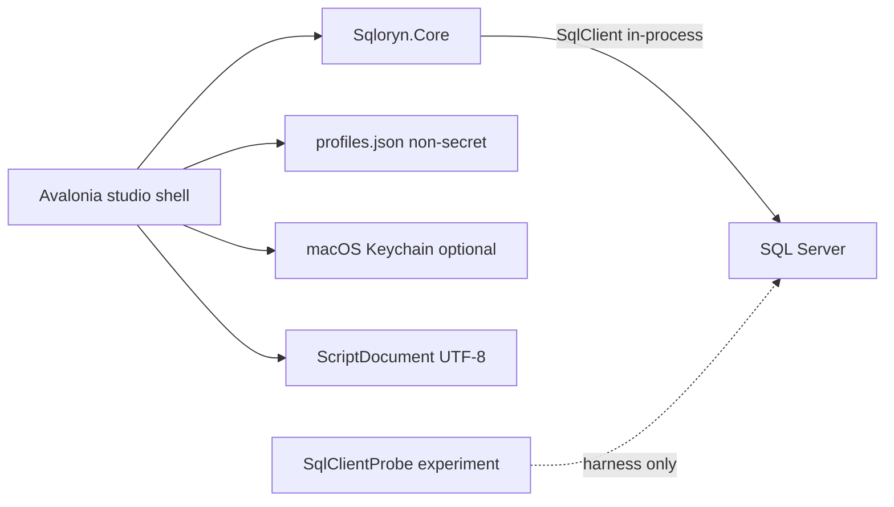

# Architecture

macOS Database Studio preview. Owner: SQLoryn maintainer. Reviewed: 2026-11-03.
Decisions: [ADR-001](decisions/001-sqlclient-probe.md),
[ADR-002](decisions/002-macos-ssh-sql-probe.md),
[ADR-003](decisions/003-desktop-avalonia.md),
[ADR-004](decisions/004-macos-database-studio.md). Spec: [SPEC-003](specs/003-macos-database-studio.md).

| Path | Role |
|---|---|
| `src/Sqloryn.Core` | Sessions, GO batches, profiles/settings stores, Keychain adapter, metadata, export, design/edit SQL, diagnostics redaction |
| `src/Sqloryn.App` | Studio UI: connect/profiles, OE, editor, DataGrid results, export, design/edit dialogs |
| `assets/icon` | Original app icon (SVG/PNG/ICNS) — not derived from Microsoft assets |
| `experiments/SqlClientProbe` | Disposable qualification harness (not the app path) |
| `scripts/run_sql_probe.py` | Local/SSH disposable server runner (lab only; not a product SSH connection) |
| `scripts/build_macos_app.sh` | Framework-dependent `.app` package with icon |

Each query tab owns a `SqlSession`. Results are applied only to the originating
tab id. Passwords are session-only unless the user opts into Remember (macOS
Keychain); encryption is mandatory; optional lab pin is explicit and mutually
exclusive with TrustServerCertificate. `GO` batch separators are split by
`GoBatchSplitter`. The App uses Avalonia.Controls.DataGrid 12.1.2 (12.1.4 is not
published on nuget.org). See [current and historical test evidence](STATE.md) for the distinction between the previously exercised arm64 desktop connection and the unverified live workflows on this branch.

## Parallel development boundaries

[The feature ownership contract](ssms/PARALLEL-TDD.md) assigns changes to the existing application and service boundaries. Workstream names are ownership labels, not a decision to introduce new processes, libraries or framework layers. Each service-specific protocol and redistribution choice needs its own evidence.
