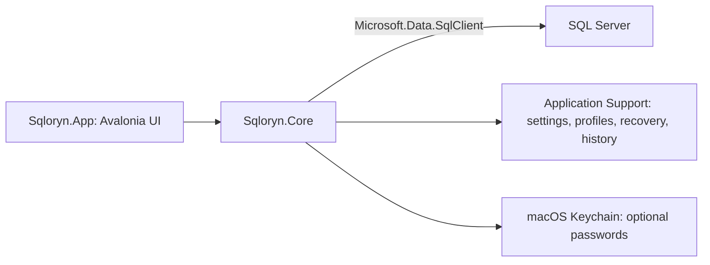

# Architecture

SQLoryn is a single-process desktop app. The Avalonia UI calls `Sqloryn.Core`, which talks to SQL Server through Microsoft.Data.SqlClient running in the same process. There is no helper process and no network service.

## Projects

| Path | Role |
|---|---|
| `src/Sqloryn.Core` | No UI code. Connection options and sessions, `GO` batch splitting and execution, result materialisation and export, Object Explorer catalog queries, table design / row edit / import / security / operations SQL builders, settings, profile, recovery and history stores, Keychain adapter |
| `src/Sqloryn.App` | Avalonia windows and dialogs: main window (Explorer, editor tabs, results), connect, settings, design/edit/import/security/operations/Agent windows |
| `tests/Sqloryn.Core.Tests` | Component tests for Core, with no SQL Server. They use fakes plus source checks of App wiring |
| `tests/Sqloryn.Core.SqlAcceptance` | Core checks against a live disposable SQL Server (see [TESTING.md](TESTING.md)) |
| `experiments/SqlClientProbe`, `tests/SqlClientProbe.Tests` | Driver/TLS probe for a disposable server, and its offline tests |
| `scripts/` | Disposable SQL Server runner, macOS app packaging, launch timing, repository checks |
| `assets/icon` | Original app icon |

## Key rules in the code

- **One session per tab.** Each query tab owns a `SqlSession`. Results and status are applied only to the tab that started the query.
- **Credentials.** Passwords stay in memory unless the user ticks Remember, which stores them in the Keychain under a key bound to the endpoint. Profiles and settings never contain passwords.
- **Encryption.** Encryption is always on. Certificate pinning and "trust server certificate" are explicit per-connection choices and cannot be combined.
- **Batches.** `GoBatchSplitter` validates the whole script before batch 1 runs. SQLCMD directives and malformed `GO` lines are rejected, with a location, and nothing runs.
- **Writes.** Every database write (design, edit rows, import, permissions, backup/restore, Agent run/delete) is built in Core. It is shown as SQL and needs confirmation. It runs in one transaction where SQL Server allows. If the commit outcome is uncertain, the result is reported as unknown and the session is not reused.
- **Results.** Retained rows and cell sizes are capped. Sort, filter and export work on retained rows only and never re-query.
- **Local files.** `AtomicFile` writes through a temporary file, using owner-only permissions. Recovery copies are written by `RecoveryWriter`, which is debounced, serialised and off the UI thread.

Design decisions are recorded in [decisions/](decisions/).
