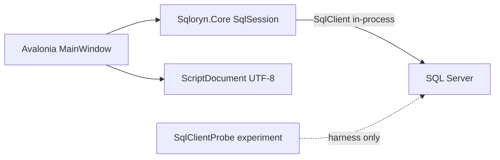

# Architecture

Developer Preview 0. Owner: SQLoryn maintainer. Reviewed: 2026-10-31.
Decisions: [ADR-001](decisions/001-sqlclient-probe.md),
[ADR-002](decisions/002-macos-ssh-sql-probe.md),
[ADR-003](decisions/003-desktop-avalonia.md).

| Path | Role |
|---|---|
| `src/Sqloryn.Core` | Connection options, session ownership, execute/cancel, metadata queries, script buffer |
| `src/Sqloryn.App` | Avalonia shell: connect, explorer, tabs, editor, results/messages |
| `experiments/SqlClientProbe` | Disposable qualification harness (not the app path) |
| `scripts/run_sql_probe.py` | Local/SSH disposable server runner |
| `scripts/build_macos_app.sh` | Framework-dependent `.app` package |

Each query tab owns a `SqlSession`. Results are applied only to the originating
tab id. Credentials are session-only; encryption is mandatory; optional lab pin
is explicit and mutually exclusive with TrustServerCertificate. Preview executes
a single batch (no GO splitter).
