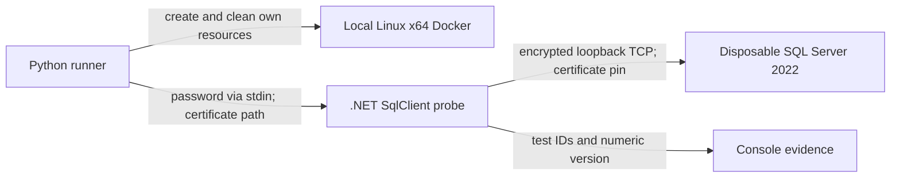

# Architecture

Experimental transport baseline; desktop decision open. Owner: SQLoryn maintainer.
Reviewed: 2026-10-31. Decision: [ADR-001](decisions/001-sqlclient-probe.md).

A .NET 10 developer probe directly exercises Microsoft.Data.SqlClient. It is an
experiment, not a production service API. No UI, IPC, credential store, general
query executor, plugin system or cloud backend exists. See [SPEC-001](specs/001-sqlclient-probe.md).

| Path | Responsibility |
|---|---|
| `experiments/SqlClientProbe/Program.cs` | Entry, deadline, cancellation, safe diagnostics |
| `experiments/SqlClientProbe/ProbeOptions.cs` | Closed arguments, bounded stdin, secure connection settings |
| `experiments/SqlClientProbe/ProbeChecks.cs` | Fixed synthetic suite; owned connections/readers; no result accumulation |
| `scripts/run_sql_probe.py` | Licence/platform gate, image, certificates/password, loopback port and cleanup |
| `tests/SqlClientProbe.Tests/` | Executable component assertions without a test framework dependency |
| `tests/test_sql_probe_runner.py` | Runner safety tests without Docker |
| `scripts/repo_preflight.py` | Repository path checks, not secret scanning |
| `.github/workflows/repository-safeguards.yml` | Mac/Linux component checks, explicitly requested SQL integration and required aggregate |

The runner creates a fresh container/network. The generated hostname, Developer
edition and SQL Server 2022 are checked before fixed synthetic SELECT, PRINT,
THROW and WAITFOR statements. No user SQL files, database contents or persistent
DDL are accepted. Passwords are absent from arguments/source/logs; the local user
and Docker administrator can still read test credentials from memory/container
configuration. No production credential or Keychain claim is made.

Connections disable pooling and connection retries. Commands/readers/connections
are disposed. Cancellation checks server activity through a second connection
and transaction state on the original session. Exact certificate pinning keeps
mandatory encryption and `TrustServerCertificate=false`; it does not test normal
CA/name/expiry validation. No trust store is modified. See [threat model](THREAT_MODEL.md).

Evaluate SQL Tools Service for language services, metadata, plans and scripting
after this baseline. Compare native AppKit/SwiftUI, Tauri and Electron using
actual editor/tree/grid accessibility, resource usage, IPC and dual-architecture
signing. Code-OSS carries fork maintenance and Marketplace restrictions. No shell
has won that comparison. Before an app, validate Keychain, authenticated local
IPC, per-tab sessions, large cells/backpressure, failed writes and Mac-to-supported-
server connectivity. See [current state](STATE.md) for the next bounded outcome.
